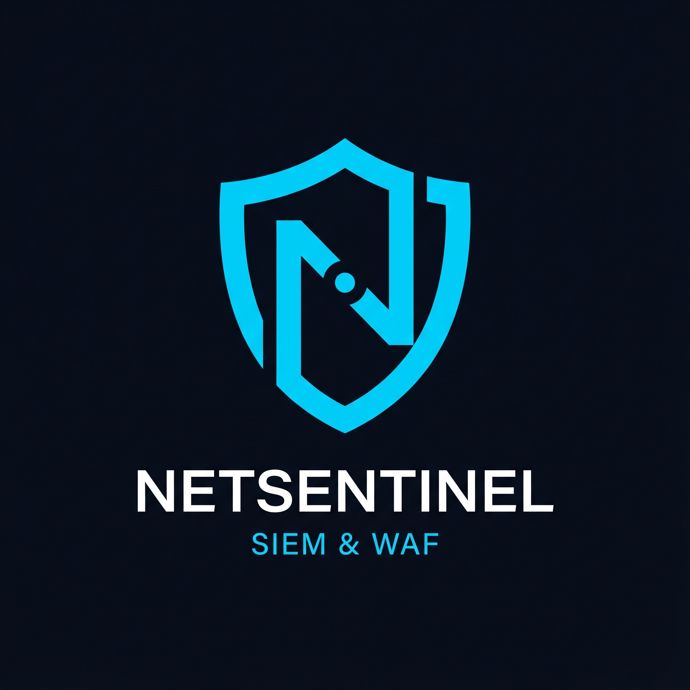
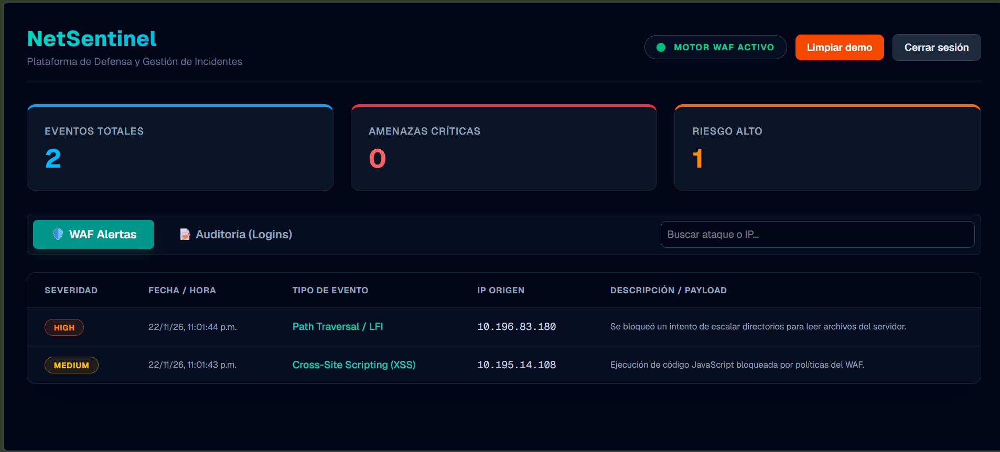

# NetSentinel — Frontend SOC Dashboard

Interfaz web de monitoreo de seguridad (**SIEM / SOC**) para **NetSentinel**, desarrollada con **Next.js (App Router)** y **Tailwind CSS**, desplegada en **Vercel** y conectada a la API segura en **Render** con persistencia en **PostgreSQL (Neon)**.

## Enlaces y Despliegue
- **Aplicación Web (Vercel):** https://seguridad-inform-tica-proyecto-fron.vercel.app
- **API Backend (Render):** https://seguridadinform-ticaproyectobackend.onrender.com
- **Repositorio Backend:** https://github.com/torao12/SeguridadInform-ticaProyectoBackend

## Funcionalidades del Panel SOC
- **Inicio de sesión con JWT:** Autenticación contra `/api/auth/login` con manejo visual de respuestas de error (`401`, `429`, `500`, `503`) y prevención de envíos duplicados.
- **Monitoreo en tiempo real:** Consulta periódica cada 3 segundos a los endpoints protegidos con `Bearer Token` usando `NEXT_PUBLIC_API_URL`.
- **KPIs y alertas WAF:** Visualización de eventos totales, amenazas críticas, riesgo alto, buscador/filtros y detalle de bloqueos (`SQLi`, `XSS`, `Path Traversal / LFI`, bots).
- **Auditoría de accesos (`audit_logs`):** Registro de inicios de sesión exitosos (`SUCCESS`) y fallidos (`FAILED`) con IP de origen y marca de tiempo.
- **Control de demostración:** Reinicio controlado de telemetría desde la interfaz (`DELETE /api/telemetry/reset`).

## Vista Previa

## Ejecución Local
1. Instala dependencias con `npm install`.
2. Configura `NEXT_PUBLIC_API_URL` (por ejemplo, `http://localhost:3001`).
3. Inicia el servidor con `npm run dev` en `http://localhost:3000`.

## Contexto Académico
- **Estudiante:** Ian Mauricio Morales Montejo (Matrícula: 243737)
- **Programa:** Ingeniería en Tecnologías de la Información e Innovación Digital — Grupo 7B
- **Asignatura:** Seguridad Informática (Periodo 263) — Universidad Politécnica de Chiapas
- **Docente:** M.C. José Alonso Macías Montoya
